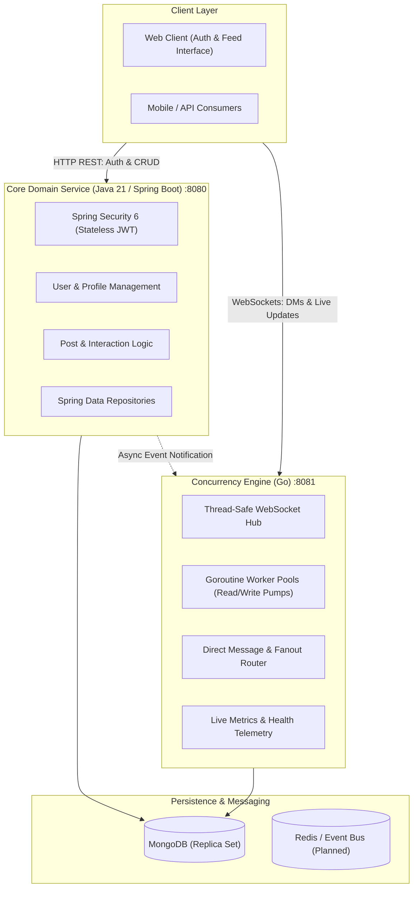

# InstaScale: High-Concurrency Polyglot Social Architecture

> A high-throughput, low-latency social platform engineered to demonstrate scalable distributed systems design by decoupling enterprise security (Java 21 / Spring Boot 3) from real-time connection pooling and event fanout (Go).

---

## 1. Motivation & Problem Statement

Building a scalable social media backend presents a fundamental compute and architectural challenge:

1. **The Architectural Conflict in Monolithic Backends**:
   - **Domain & Security Workload**: User authentication, token lifecycle management, access control, relational invariants, and transactional data validation require strict type safety and mature security abstractions.
   - **High-Concurrency I/O Workload**: Managing hundreds of thousands of concurrent WebSocket connections for real-time messaging, typing indicators, and live activity streams demands minimal memory per socket and non-blocking I/O.
2. **The JVM Concurrency Penalty**:
   - Maintaining 50,000+ persistent WebSocket connections inside traditional thread-per-request JVM servers consumes excessive RAM and induces heavy context-switching overhead.
3. **Write Amplification in Feed Fanout**:
   - Naive fanout-on-write mechanisms collapse when high-follower accounts ("celebrity problem") post, triggering millions of simultaneous database writes.

### The Solution: The Polyglot Microservice Architecture
Instead of forcing a single runtime to handle both concerns suboptimally, **InstaScale** decouples responsibilities:
- **Core Security & Business Domain (`Java 21` + `Spring Boot 3.3`)**: Handles cryptographic password hashing, stateless JWT authorization, and MongoDB data mapping.
- **Concurrency & Real-Time Engine (`Go`)**: Manages high-density WebSocket connection pooling via lightweight Goroutines (~2 KB overhead each), handling message routing and fanout dispatch with minimal latency.
- **Document Store (`MongoDB 8.x`)**: Optimized with compound indexes for rapid user lookups, timeline sorting, and conversational queries.

---

## 2. System Architecture



---

## 3. Technology Stack & Key Decisions

| Tier | Technology | Strategic Rationale |
| :--- | :--- | :--- |
| **Core Service** | **Java 21, Spring Boot 3.3** | Mature ecosystem for enterprise security, compile-time type verification, and structured exception handling. |
| **Security** | **Spring Security 6, JJWT 0.12.6** | Stateless authentication using HMAC-SHA256 signed JWTs with rotating refresh tokens and BCrypt password encryption. |
| **Realtime Service** | **Go 1.22+, Gorilla WebSockets** | Extremely low memory footprint per socket (~2 KB vs ~1 MB in traditional OS threads), enabling C10K+ concurrent connections with zero GC pauses. |
| **Database** | **MongoDB 8.x** | Flexible schema evolution for posts, media arrays, and interactions with compound B-tree indexing. |
| **Frontend** | **Modern Semantic HTML5/CSS3/ES6** | Zero-dependency, performant client featuring floating labels, double-tap heart animations, and instant WebSocket chat. |

---

## 4. Key Engineering Implementations

### A. Thread-Safe Go WebSocket Hub
- **Connection Multiplexing**: Manages active sessions per user using a read-write mutex guarded map (`map[string]map[*Client]bool`), gracefully supporting multiple browser tabs/devices per user.
- **Heartbeat & Zombie Detection**: Automated ping/pong pumps prevent stale TCP connections from accumulating.
- **Message Routing Pipeline**: Serializes JSON payloads and routes messages directly to target user channels without broadcasting across disconnected clients.

### B. Secure Token-Based Ingress (Spring Boot)
- **Custom Authentication Filter**: Intercepts requests, validates JWT claims without touching the database on every call, and populates the `SecurityContext`.
- **CORS & Ingress Isolation**: Strict origin mapping preventing unauthorized cross-origin socket upgrades.

---

## 5. Repository Structure

```
├── backend-core/                      # Java 21 & Spring Boot Core Service
│   ├── pom.xml                        # Maven dependencies & plugins
│   └── src/main/java/com/instagram/core/
│       ├── controller/                # AuthController (/api/v1/auth/*), UserController
│       ├── dto/                       # Immutable Java 21 Records (DTOs)
│       ├── model/                     # MongoDB Document Models (User, Role)
│       ├── repository/                # Spring Data MongoDB Repositories
│       ├── security/                  # JwtService, JwtFilter, SecurityConfig
│       └── service/                   # AuthService, UserService
│
├── backend-concurrency/               # Go Real-Time Engine
│   ├── go.mod / go.sum
│   ├── main.go                        # HTTP endpoints, WebSocket upgrader & telemetry
│   ├── concurrency-service.exe        # Pre-compiled high-performance binary
│   └── hub/
│       ├── hub.go                     # Thread-safe client state & message router
│       └── client.go                  # Dedicated read/write pump goroutines
│
├── index.html                         # Authentication UI with CSS micro-interactions
├── feed.html                          # Main application (Feed, Stories, Create Post, Live Chat)
├── start-servers.bat                  # One-click multi-service launcher
└── README.md
```

---

## 6. Getting Started

### Prerequisites
- **MongoDB**: Active service on `localhost:27017`
- **JDK**: Java 21 LTS
- **Build Tools**: Maven 3.9+
- **Go**: 1.22+

### Running the Services

#### Option 1: One-Click Windows Launcher
Run the automated batch script from the project root:
```powershell
.\start-servers.bat
```
This initializes the Go engine (Port 8081), builds and starts Spring Boot (Port 8080), and launches the client in your default browser.

#### Option 2: Manual Initialization
1. **Start the Go Concurrency Service**:
   ```powershell
   cd backend-concurrency
   .\concurrency-service.exe
   ```
2. **Start the Java Core Service**:
   ```powershell
   cd backend-core
   mvn spring-boot:run
   ```
3. **Open the Client**:
   Navigate to `file:///D:/Desktop/gofiles/faltu/index.html` or `feed.html`.

---

## 7. Performance & Architecture Roadmap

- [x] **Phase 1: Foundation & Polyglot Core**
  - [x] Spring Boot 3 + Java 21 stateless JWT authentication pipeline.
  - [x] MongoDB user document schema with unique indexing.
  - [x] Go WebSocket connection hub with telemetry (`/api/v1/stats`).
  - [x] Responsive client interface with real-time DM integration.
- [ ] **Phase 2: Feed Fanout Optimization**
  - [ ] Implement **Fanout-on-Write (Push)** for accounts with $< 25,000$ followers into Redis feed caches.
  - [ ] Implement **Fanout-on-Read (Pull)** for verified/celebrity accounts to eliminate write storms.
- [ ] **Phase 3: Event-Driven Decoupling**
  - [ ] Introduce Kafka / Redis Streams to decouple Spring Boot post events from Go feed fanout workers.
- [ ] **Phase 4: Load Testing & Benchmarks**
  - [ ] Execute `k6` load scripts simulating 50,000 active concurrent WebSocket connections to measure memory utilization and p99 latency.
